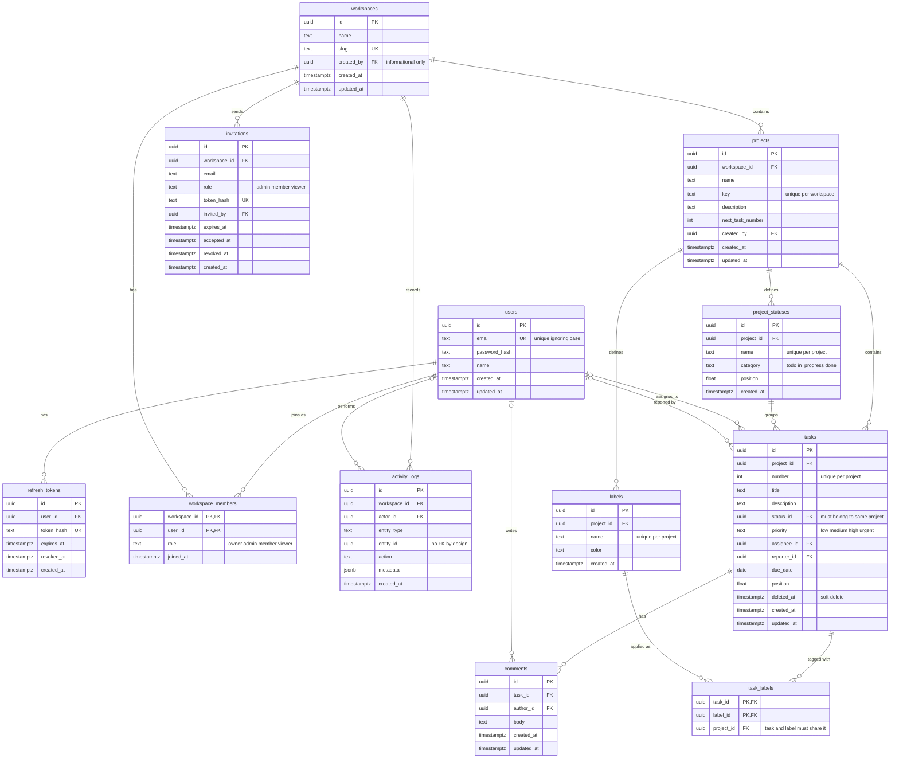

# Database schema

Current as of migration 5. Rebuild from scratch with `migrate ... up`.

The diagram leaves out the `created_by` and `invited_by` links to `users` to keep it readable. They appear as FK columns in the tables.

## Rules the database enforces

- Emails, slugs, project keys, status names, and label names can't be duplicated (case-insensitive where it matters).
- A task's status must belong to the task's own project (composite foreign key).
- A label can only be attached to a task in the same project (composite foreign keys).
- A user can be in a workspace only once, with one of four valid roles.
- Task numbers are unique per project.
- Invitations can't grant the owner role, and only one can be pending per email per workspace.
- Deleting a user keeps workspaces, tasks, comments, and logs (the user reference becomes empty).
- Deleting a workspace removes everything inside it.

## Rules the Go code must enforce

- At least one owner must always remain in a workspace, and admins can't demote owners.
- An assignee must be a member of the task's workspace.
- Creating a task uses the `next_task_number` counter inside a transaction.
- Creating a project inserts the four default statuses in the same transaction.
- A status can't be deleted while tasks (including soft-deleted ones) still use it.
- Re-inviting an email first revokes the old pending invitation.
- Accepting an invitation requires the logged-in user's email to match the invited email.
- Only the service layer writes `activity_logs`.
